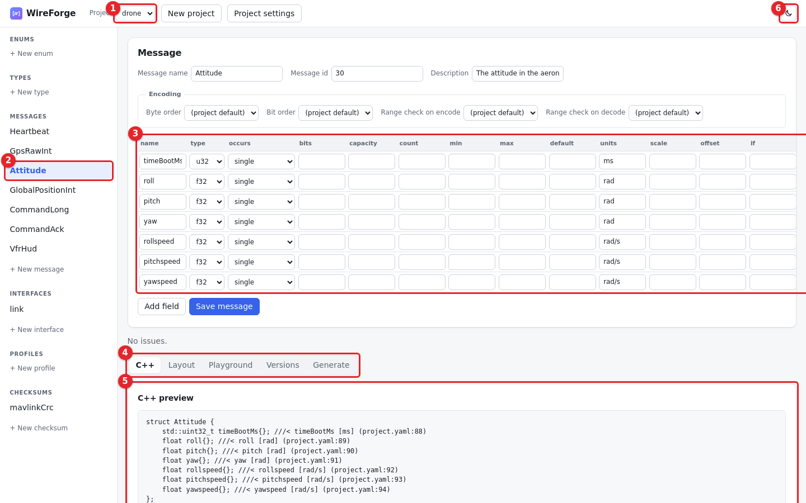
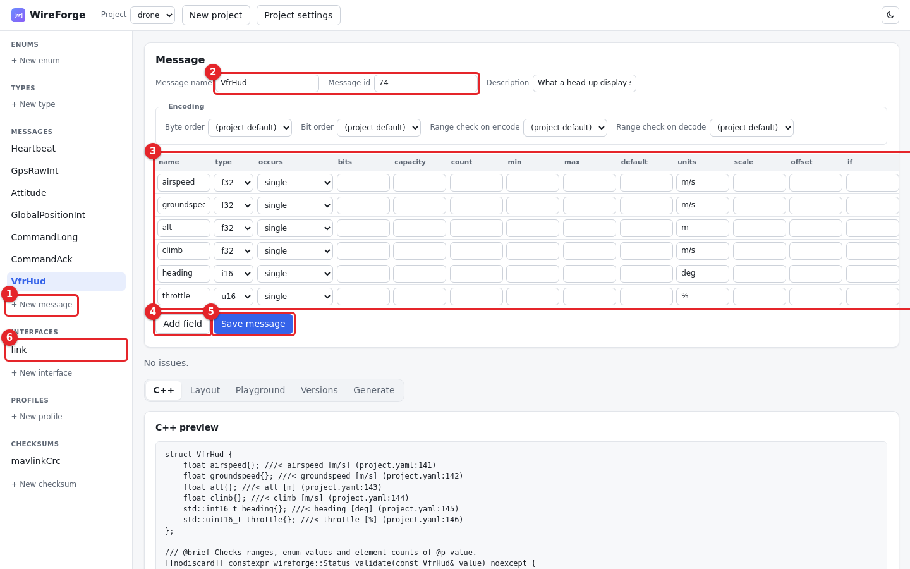
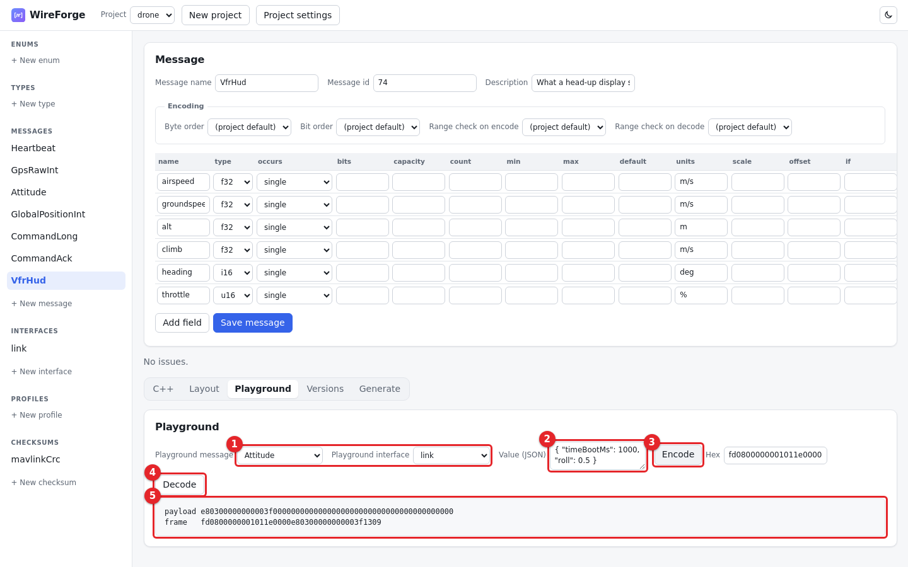
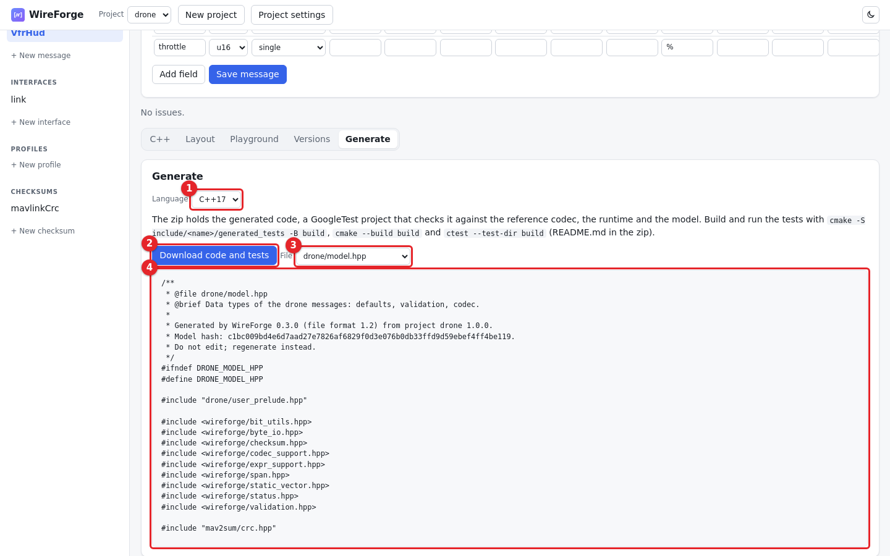

# 2. The web UI

**What we will do:** open the project in the web UI, look at a message, add the VFR_HUD message (what a head-up display
shows: speeds, altitude, heading), try frames in the Playground and download the generated code.

## Start the server
```sh
wireforge serve --workspace .
```
Open <http://127.0.0.1:8000>. Every directory of the workspace with a `project.yaml` is a project.



1. **Project:** pick `drone`.
2. **Entries:** the parts of the model (enums, types, messages, interfaces, profiles, checksums). Click **Attitude**.
3. **Fields:** the fields of the message in the order they are sent, with type, occurrence, bits, limits, default,
   units and scaling.
4. **Tools:** C++, Layout, Playground, Versions and Generate, for the selected project.
5. **C++ preview:** the generated struct of the selected message and its functions.
6. **Theme:** switches between the light and the dark theme.

The files stay the source of truth: whatever you save in the UI is written to `drone/project.yaml` in the same layout a
hand edit has, so `git diff` shows exactly what changed.

## Add a message
VFR_HUD (message id 74) has six fields. In MAVLink order (the largest types first):

| Field | Type | Units |
|-------|------|-------|
| airspeed | f32 | m/s |
| groundspeed | f32 | m/s |
| alt | f32 | m |
| climb | f32 | m/s |
| heading | i16 | deg |
| throttle | u16 | % |



1. Click **New message** under Messages.
2. Name it `VfrHud`, set the message id to `74` and the description to `What a head-up display shows (VFR_HUD).`
3. Fill the rows of the field table from the table above.
4. **Add field** adds a row; add six. The editor checks names, types and limits while you type; problems are listed
   under the table and block saving.
5. Click **Save message**.
6. Open the interface **link**, click **Add message**, choose `VfrHud` and click **Save interface**.

The same from the terminal, if you prefer it (stop the server first, or use a second terminal):
<!-- tutorial: run -->
```sh
wireforge upsert drone messages VfrHud '{ id: 74, description: "What a head-up display shows (VFR_HUD).", fields: [{ name: airspeed, type: f32, units: m/s }, { name: groundspeed, type: f32, units: m/s }, { name: alt, type: f32, units: m }, { name: climb, type: f32, units: m/s }, { name: heading, type: i16, units: deg }, { name: throttle, type: u16, units: "%" }] }'
wireforge set drone /interfaces/link/messages/- VfrHud
```

### The checksum byte of a new message
MAVLink adds one extra byte to the checksum of every frame, CRC_EXTRA, that depends on the message definition. The model
keeps these bytes in one list, `drone/app/include/mav2sum/crc_extra.h`, which the generated C and C++ code and the
Python reference use. Add the line for VFR_HUD above the marker line:
```c
    X(77U, 143U) /* COMMAND_ACK */ \
    X(74U, 20U)  /* VFR_HUD */ \
    /* add new messages above this line */
```
The value comes from the MAVLink definitions; pymavlink prints it with
`python -c "from pymavlink.dialects.v20 import common; print(common.MAVLink_vfr_hud_message.crc_extra)"`.

<!-- tutorial: hidden
python - <<'PY'
from pathlib import Path
table = Path("drone/app/include/mav2sum/crc_extra.h")
marker = "    /* add new messages above this line */"
table.write_text(table.read_text().replace(marker, "    X(74U, 20U)  /* VFR_HUD */ \\\n" + marker))
PY
-->

<!-- tutorial: run -->
```sh
wireforge validate drone
```

## Try frames in the Playground
Open the **Playground** tab (4 in the first picture).



1. Choose the message `Attitude` and the interface `link`.
2. Enter the value `{ "timeBootMs": 1000, "roll": 0.5 }` (fields you leave out keep their defaults).
3. Click **Encode**.
4. **Decode** turns the hex in the *Hex* box back into values.
5. The result: the 28-byte payload and the frame. The frame is 20 bytes instead of 40, because the last five fields
   (pitch, yaw and the three angular speeds) are zero and are not sent.

**Layout** shows the offset, size and bit position of every field and the RAM a link needs. **Versions** compares the
working copy with any earlier git commit (chapter 6).

## Download the code


1. **Language:** C++17 or C99.
2. **Download code and tests:** a zip with the generated code, its GoogleTest project, the runtime, the model and a
   README with the commands that build and run the tests.
3. **File:** every generated file of the project.
4. The selected file.

**More:** [Web UI](../UI.md), [team server](../SERVER.md).

**If something goes wrong:** `wireforge serve` needs the `server` extra (`pip install "wireforge[server]"`). Port 8000
in use: `--port 8080`. A save that is refused shows the reason under the editor; the file was not changed.

Next: [3. Your own protocol](03_your_own_protocol.md)
