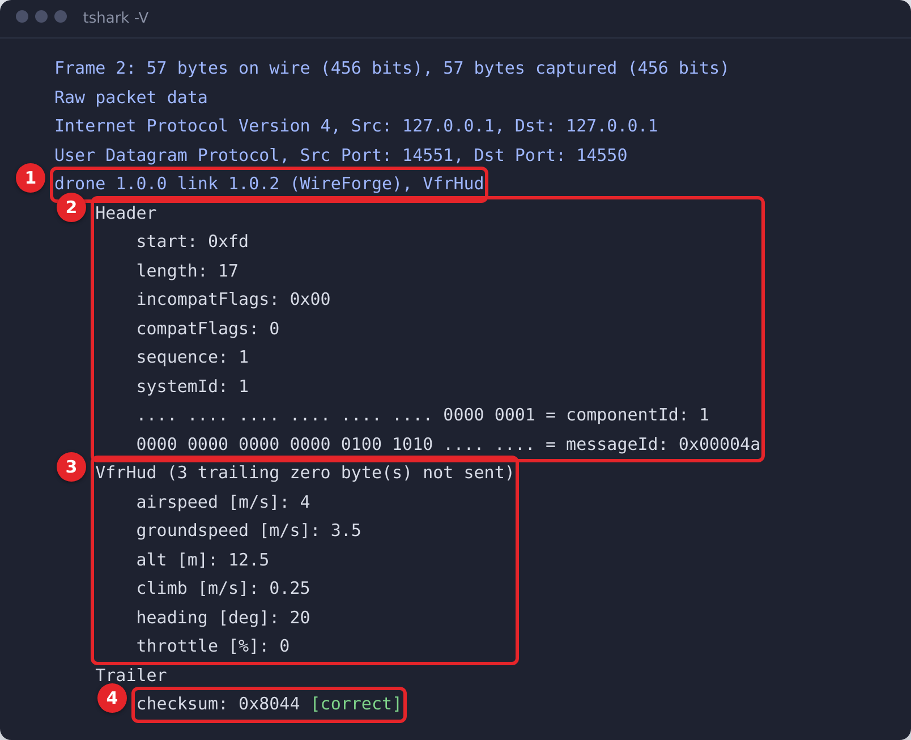

# 8. Wireshark

**What we will do:** generate a Wireshark dissector for `drone` and look at the vehicle's traffic.

## The dissector
<!-- tutorial: run -->
```sh
wireforge wireshark drone -o drone.lua
```
`drone.lua` is a Lua plugin for Wireshark 3.6 or newer, and `drone/wireshark/mav2sum.lua` the hook that verifies
MAVLink's checksum, with the CRC_EXTRA byte of every message (VFR_HUD's too: the hook reads the project's
`crc_extra.h`). Start Wireshark with both:
```sh
wireshark -X lua_script:drone.lua -X lua_script:drone/wireshark/mav2sum.lua
```
To load them at every start instead, copy them into your personal plugin directory (Wireshark shows it under *Help >
About Wireshark > Folders*), with `drone/app/include/mav2sum/crc_extra.h` next to the hook.

## Look at the traffic
Start a capture on the loopback interface with the filter `udp port 14550`, run the vehicle and the ground station of
chapter 4 again, and tell Wireshark that UDP port 14550 carries `drone_link`: *Analyze > Decode As*, or the protocol
preference *UDP port*.

Every frame becomes a tree. Here is a VFR_HUD frame of the vehicle:



1. The protocol item names the project, the interface with its version, and the message.
2. The header: every field of the model, and the bits of `componentId` and `messageId`, which share one 32-bit group.
3. The message, with units. A frame whose trailing zeros were not sent is dissected as the whole message, and the item
   says how many zero bytes were left out.
4. The checksum, verified by the hook with the message's CRC_EXTRA byte. Display filters use the field
names of the model:
```text
drone_link.VfrHud.alt > 10
drone_link.header.sequence == 42
```
A broken frame is marked with the status the generated decoder returns (`[ChecksumMismatch]`, `[InvalidLength]`, ...).

Without the GUI, `tshark` shows the same:
```sh
tshark -i lo -f "udp port 14550" -X lua_script:drone.lua -X lua_script:drone/wireshark/mav2sum.lua -o drone_link.udp_port:14550 -V
```

**More:** [Wireshark dissector](../WIRESHARK.md).

**If something goes wrong:** no `drone_link` in the packet list: the port preference is not set. `Checksum not
verified`: the hook `mav2sum.lua` is not loaded.

Next: [9. AI agents (MCP)](09_ai_agents_mcp.md)
