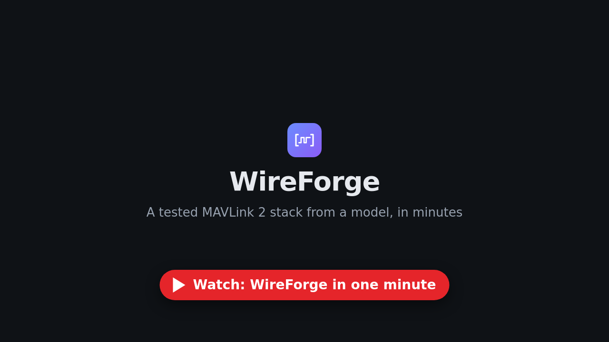

# WireForge tutorial

This tutorial builds one thing from start to end: the MAVLink 2 link of a small drone. You start from the published
MAVLink 2 model, add a message, generate C++ for it, run the tests that check the code, use it in an application that
talks to an independent MAVLink implementation (pymavlink), check every change in CI, look at the traffic in Wireshark
and let an AI agent edit the model. The last chapters show the team server and the documents for teams with an
assurance process.

The one-minute video shows the way the tutorial goes, from the model to a vehicle that talks to pymavlink.

The commands of the tutorial run in the continuous integration of WireForge (`quality/run_tutorial.py`), all but the
ones that need a GUI, Wireshark or an AI agent, so what you read here works with the version it belongs to.

## Developer track
| Chapter | You will | Time |
|---------|----------|------|
| [1. Install and the first project](01_install_first_project.md) | install WireForge, start from MAVLink 2, encode frames, run the generated tests | 10 min |
| [2. The web UI](02_web_ui.md) | browse the model, add the VFR_HUD message, try frames in the Playground, download the code | 15 min |
| [3. Your own protocol](03_your_own_protocol.md) | turn an ICD table into a project, learn the parts of a model, import a whole MAVLink dialect | 15 min |
| [4. Use the code](04_use_the_code.md) | build a vehicle that sends MAVLink 2 over UDP and answers commands, in C++ and in C; check it with pymavlink and talk to ArduPilot's simulator | 30 min |
| [5. On a microcontroller](05_on_a_microcontroller.md) | run the same vehicle in C on a Cortex-M4 (in QEMU) or a real STM32 board, MAVLink 2 over its UART | 20 min |
| [6. Tests](06_tests.md) | see what the generated tests check, measure coverage, read the results | 10 min |
| [7. Versions and CI](07_versions_and_ci.md) | tell a compatible change from a breaking one and check every pull request | 10 min |
| [8. Wireshark](08_wireshark.md) | see the frames of your protocol, checksums included | 10 min |

## Advanced track
| Chapter | You will | Time |
|---------|----------|------|
| [9. AI agents (MCP)](09_ai_agents_mcp.md) | let Claude or another agent edit the model safely | 10 min |
| [10. Team server](10_team_server.md) | run the web UI for a team, with a token or in Docker | 10 min |
| [11. Documents and evidence](11_documents_and_evidence.md) | generate requirements, design, test and traceability documents | 15 min |

## What you need
- Python 3.10 to 3.13 and `pip`.
- A C++17 compiler, CMake 3.21 or newer and Ninja or Make (chapters 1, 4, 5 and 6 build code).
- For chapter 4, Linux or macOS (the example uses POSIX sockets) and `pip install pymavlink`.
- For chapter 5, the Arm GCC toolchain and QEMU (`sudo apt install gcc-arm-none-eabi libnewlib-arm-none-eabi qemu-system-arm`).
- For chapter 8, Wireshark 3.6 or newer (or `tshark`).

Work in an empty directory; every chapter continues where the previous one stopped. If you lose your way, start again
from chapter 1: it takes a minute.

MAVLink is a project of the Dronecode Foundation; WireForge is not affiliated with or endorsed by it.
